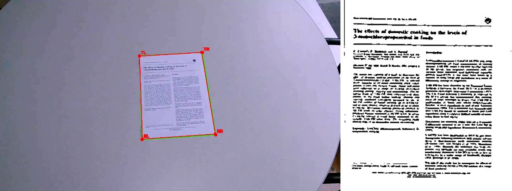
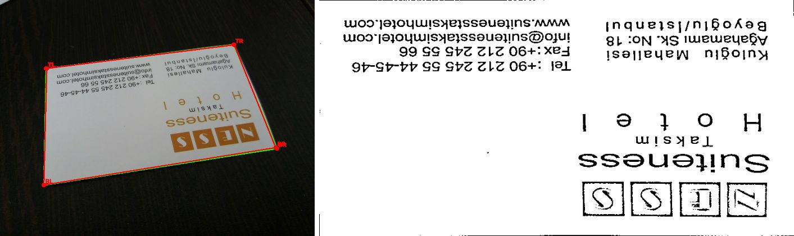
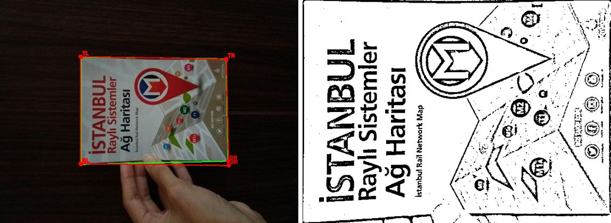
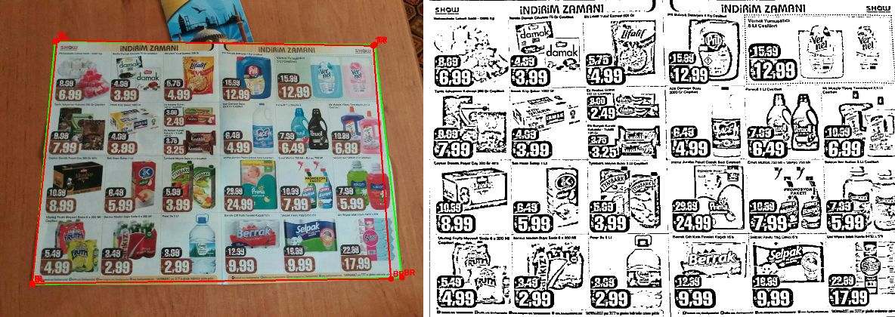
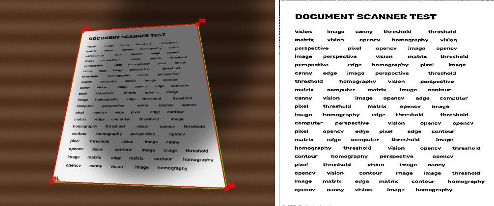
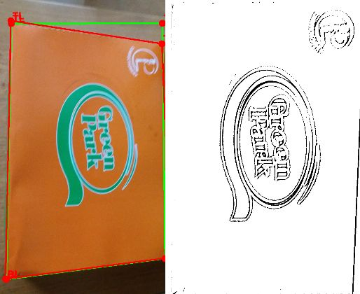
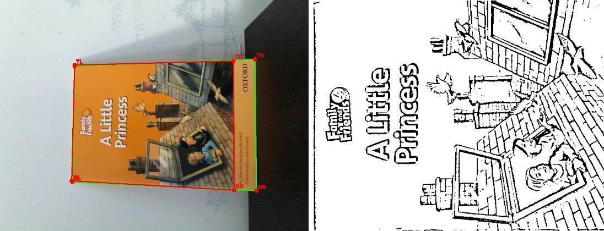
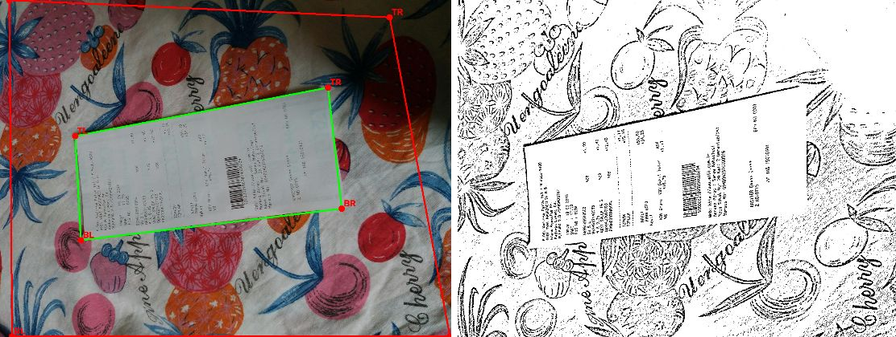
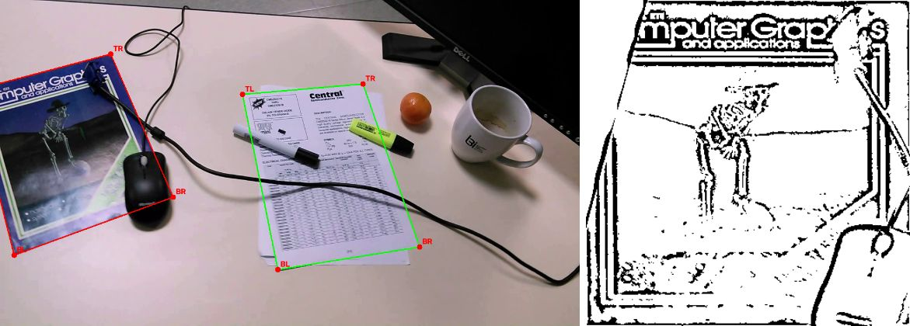
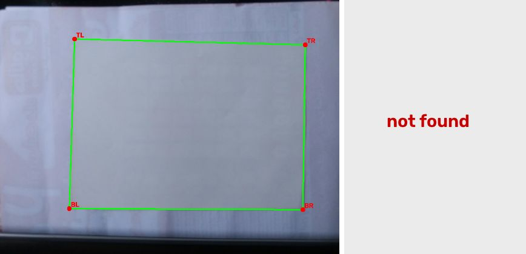

# Інтелектуальний сканер документів

Індивідуальний проєкт з дисципліни «Комп'ютерний зір», варіант 13.
Автор: Назарій Данильчук.

## Задача

Програма знаходить аркуш документа на фотографії, виправляє перспективу,
обрізає зайві ділянки, підсилює контрастність і зберігає результат.

## Архітектура

```
                           ┌─ 8 карт країв (Canny: gray, B/G/R, низькі пороги; Otsu) ─► контури ─► approxPolyDP ─┐
Фото ─► зменшення, gray, ──┤                                                                                    ├─► фільтр ─► оцінка ─► кращий ─► гомографія ─► підсилення ─► скан
        розмиття Гауса     └─ відрізки LSD ─► 2 групи напрямків (k-means) ─► перетини пар прямих ───────────────┘   (кути,    (контраст ×  4-кутник   (warpPerspective) (adaptive
                                                                                                                      площа)    опора × площа)                              threshold / CLAHE)
```

| Модуль | Відповідальність |
|--------|------------------|
| `app.py` | веб-демонстрація (Streamlit) |
| `src/scanner.py` | алгоритм: обробка, пошук контуру, гомографія, підсилення |
| `src/main.py` | CLI, режим debug, збереження |
| `src/check_env.py` | перевірка залежностей і тестових даних |
| `src/make_synthetic.py` | генерація синтетичних тестів з відомими кутами |
| `src/evaluate.py` | оцінка точності: IoU, похибка кутів, час; звіт CSV і найгірші випадки |
| `src/datasets.py` | завантажувачі розмітки: ground_truth.json, Mendeley (csv), SmartDoc (avi + gt.xml); поділ tune/test |
| `src/tune.py` | підбір параметрів перебором сітки на частині tune |
| `src/extract_parquet.py` | витягування jpg + розмітки з parquet (DocCornerDataset) |

Детальний аналіз і обґрунтування вибору методів — [docs/01_analysis.md](docs/01_analysis.md).

## Методика

Рішення не повторює одну конкретну публікацію: воно поєднує класичний конвеєр сканера
документів, схему «генерація → перевірка гіпотез» і стандартну експериментальну методику.

### 1. Базовий підхід — класичний конвеєр сканера документів

Знайти межі → знайти чотирикутник → вирівняти перспективу → підсилити контраст
(Canny → `findContours` → `approxPolyDP` → перетворення за 4 точками → бінаризація) [1].
Це стратегія `simple`; її залишено як базову лінію для порівняння.

### 2. Розширення — генерація та перевірка гіпотез (generate-and-verify)

Базовий підхід шукає один контур на одній карті країв і часто помиляється
(на тестових даних — 13–20 % успіху). Тому пошук документа перебудовано за схемою,
близькою до описаної Dropbox для мобільного сканування [2]:

1. **Генерація гіпотез** — кандидати-чотирикутники з кількох незалежних джерел:
   - 8 карт країв: Canny на яскравості (автопоріг і низький поріг), на кожному каналі
     B, G, R окремо (межа «білий аркуш / кольоровий стіл» помітна за кольором, але не за
     яскравістю), межі областей після бінаризації Otsu яскравості й насиченості;
   - прямі лінії: відрізки LSD → дві групи за напрямком (k-means на подвоєному куті) →
     чотирикутники з перетинів двох пар прямих. Знаходить документ, навіть коли частину
     сторони закриває рука.
2. **Перевірка гіпотез:**
   - геометричний фільтр: внутрішні кути 50–130°, площа 5–95 % кадру, вершини не далеко за кадром;
   - оцінка = **контраст з фоном** (різниця середнього кольору Lab всередині й у смузі навколо)
     × **опора на краї** (частка периметра на знайдених краях) × **площа**^0.5;
   - правило: якщо переміг чотирикутник з прямих, але він лежить усередині найкращого
     контура (межі колонок, рамки на сторінці), обирається контур.
3. **Корекція перспективи** обраного чотирикутника гомографією і **підсилення** результату.

У Dropbox краї знаходить навчена модель; тут — лише класичні методи, тому кожен крок
можна пояснити й перевірити.

### 3. Методи комп'ютерного зору

| Етап | Метод | Джерело |
|------|-------|---------|
| Пошук країв | детектор Canny | Canny, 1986 [3] |
| Контури | трасування меж (`cv2.findContours`) | Suzuki & Abe, 1985 [4] |
| Спрощення контуру | алгоритм Дугласа–Пекера (`cv2.approxPolyDP`) | Douglas & Peucker, 1973 [5] |
| Пошук прямих | Line Segment Detector (`cv2.createLineSegmentDetector`) | Grompone von Gioi et al., 2010 [6] |
| Бінаризація областей | метод Otsu | Otsu, 1979 [7] |
| Корекція перспективи | гомографія за 4 парами точок | Hartley & Zisserman [8] |
| Підсилення | адаптивна бінаризація (Гаусове вікно); CLAHE | Zuiderveld, 1994 [9] |

### 4. Методика розробки та оцінки

- **Протокол SmartDoc 2015 (ICDAR)** [10]: метрика — IoU (індекс Жаккара) між знайденим і
  еталонним чотирикутником; успіх — IoU ≥ 0.9. Відмінність від оригіналу: IoU рахується
  в координатах кадру, а не в системі координат документа.
- **Датасети:** SmartDoc 2015 Challenge 1 (150 відео, 5 фонів), Mendeley «Document Corner
  Localization» (~1100 фото з телефона), синтетичні зображення з точно відомими кутами.
- **Розробка, керована аналізом помилок:** прогін → перегляд найгірших випадків →
  гіпотеза про причину → зміна → повторний прогін. Так з'явились кольорові канали,
  кандидати з прямих і правило «прямі всередині контура».
- **Поділ tune / test:** параметри підбирались лише на ~30 % даних (tune), підсумкові
  цифри — на решті (test). Поділ детермінований: SmartDoc — за документом, Mendeley — за хешем назви.
- **Абляційний аналіз:** внесок кожної зміни виміряно окремо; зміни без приросту
  (уточнення сторін `fitLine`, рамка кадру на картах країв) не увійшли до фінальної версії.
- **Підбір параметрів** перебором сітки (1296 комбінацій, `src/tune.py`). Найкраща на tune
  комбінація виявилась перенавченою (на test −14 % на SmartDoc), тому обрано стійкіший варіант.

Деталі й усі цифри — [docs/03_testing.md](docs/03_testing.md).

### Джерела

1. A. Rosebrock. *How to Build a Kick-Ass Mobile Document Scanner in Just 5 Minutes.* PyImageSearch, 2014. https://pyimagesearch.com/2014/09/01/build-kick-ass-mobile-document-scanner-just-5-minutes/
2. Dropbox Tech. *Fast and Accurate Document Detection for Scanning.* 2016. https://dropbox.tech/machine-learning/fast-and-accurate-document-detection-for-scanning
3. J. Canny. *A Computational Approach to Edge Detection.* IEEE TPAMI, 8(6), 1986.
4. S. Suzuki, K. Abe. *Topological Structural Analysis of Digitized Binary Images by Border Following.* CVGIP, 30(1), 1985.
5. D. Douglas, T. Peucker. *Algorithms for the Reduction of the Number of Points Required to Represent a Digitized Line or its Caricature.* Cartographica, 10(2), 1973.
6. R. Grompone von Gioi, J. Jakubowicz, J.-M. Morel, G. Randall. *LSD: A Fast Line Segment Detector with a False Detection Control.* IEEE TPAMI, 32(4), 2010.
7. N. Otsu. *A Threshold Selection Method from Gray-Level Histograms.* IEEE Trans. SMC, 9(1), 1979.
8. R. Hartley, A. Zisserman. *Multiple View Geometry in Computer Vision.* Cambridge University Press, 2004.
9. K. Zuiderveld. *Contrast Limited Adaptive Histogram Equalization.* Graphics Gems IV, 1994.
10. J.-C. Burie et al. *ICDAR 2015 Competition on Smartphone Document Capture and OCR (SmartDoc).* ICDAR, 2015. Дані: https://doi.org/10.5281/zenodo.1230217

## Використані методи

Нижче — кожен крок конвеєра: що робить метод, як він працює, чому обраний і що змінює
кожен параметр. Значення за замовчуванням — у `ScanConfig` (`src/scanner.py`); будь-який
параметр можна змінити: `--set ключ=значення` або повзунком у веб-демонстрації.

### 1. Попередня обробка: зменшення, сірий, розмиття Гауса

`preprocess()` — `cv2.resize(INTER_AREA)`, `cv2.cvtColor(BGR2GRAY)`, `cv2.GaussianBlur`

- **Зменшення до висоти 500 px** (`work_height`). Пошук документа — найдовша частина;
  на 500 px він у десятки разів швидший, а межа аркуша все ще чітка. Знайдені кути потім
  множаться на коефіцієнт масштабу, і корекція перспективи виконується на **оригіналі** —
  якість скану не втрачається. `INTER_AREA` усереднює пікселі й не створює муару при зменшенні.
- **Розмиття Гауса** — згортка з ядром $G(x,y)=\frac{1}{2\pi\sigma^2}e^{-(x^2+y^2)/2\sigma^2}$.
  Придушує шум і дрібну текстуру (зерно паперу, текст), щоб Canny реагував на межу аркуша, а не на літери.

| Параметр | За замовч. | Більше значення | Менше значення |
|----------|-----------|-----------------|----------------|
| `blur_ksize` | 5 | менше шуму й тексту, але межі розмиваються, кути зміщуються | більше дрібних країв (текст, текстура столу) |

### 2. Детектор країв Canny

`cv2.Canny(img, low, high)`

Алгоритм: (1) градієнт яскравості фільтром Собеля — модуль і напрямок; (2) **non-maximum
suppression** — лишаються лише локальні максимуми вздовж напрямку градієнта, край стає
тонким (1 px); (3) **подвійний поріг з гістерезисом**: пікселі з градієнтом > `high` — точно
край; між `low` і `high` — край, лише якщо з'єднаний із сильним; < `low` — відкидаються.

**Автопоріг** (`auto_canny_thresholds`): `low = (1−σ)·m`, `high = (1+σ)·m`, де `m` — медіана
яскравості. Пороги підлаштовуються під експозицію кадру.

**Чому кілька карт країв (стратегія `multi`):** один набір порогів не працює для всіх умов.
Білий аркуш на помаранчевому столі в градаціях сірого майже не відрізняється від фону —
але дуже відрізняється в каналі B. Тому будуються 8 карт:

| Карта | Що це | Коли допомагає |
|-------|-------|----------------|
| `gray_auto` | Canny на сірому з автопорогом | звичайний контрастний знімок (класичний варіант) |
| `gray_low` | Canny на сірому, пороги 10/40 | слабкий контраст: білий аркуш на світлому столі |
| `bgr_high`, `bgr_low` | Canny окремо на каналах B, G, R (40/120 і 20/60), об'єднання | межа видна лише за кольором |
| `otsu_gray(_inv)`, `otsu_sat(_inv)` | межі областей після бінаризації Otsu яскравості й насиченості | суцільний аркуш як «пляма» на фоні; не залежить від тексту всередині |

| Параметр | За замовч. | Ефект |
|----------|-----------|-------|
| `canny_sigma` (σ) | 0.33 | більше → ширший діапазон, більше слабких країв; менше → лише найсильніші |
| `--canny LOW HIGH` | авто | ручні пороги (стратегія `simple`): нижчі → більше країв і шуму, вищі → межа може розірватися |

### 3. Бінаризація Otsu

`cv2.threshold(img, 0, 255, THRESH_BINARY + THRESH_OTSU)`

Автоматично обирає поріг $t$, що **максимізує міжкласову дисперсію** гістограми:
$\sigma_b^2(t)=\omega_0(t)\,\omega_1(t)\,[\mu_0(t)-\mu_1(t)]^2$, де $\omega$ — частки пікселів
у двох класах, $\mu$ — їхні середні. Добре працює, коли гістограма двогорба: світлий аркуш і темний фон.
Застосовується до яскравості та **насиченості** (HSV, канал S): білий папір має насиченість
≈ 0, а кольоровий стіл — високу. Після бінаризації — морфологічне **відкриття** 7×7
(ерозія + дилатація) прибирає дрібні плями, потім Canny дає межу області.

### 4. Морфологічне закриття

`cv2.morphologyEx(edges, MORPH_CLOSE, kernel)`

Закриття = **дилатація, потім ерозія**. Дилатація «розтягує» краї й з'єднує розриви
(межа аркуша часто переривається відблиском чи тінню), ерозія повертає товщину назад.
Без цього контур аркуша незамкнений і `findContours` не дає чотирикутника.

| Параметр | За замовч. | Більше | 0 |
|----------|-----------|--------|---|
| `morph_ksize` | 5 | закриває більші розриви, але може «склеїти» аркуш із сусідніми предметами | вимкнено |

### 5. Контури і спрощення контуру (Дуглас–Пекер)

`cv2.findContours(RETR_LIST, CHAIN_APPROX_SIMPLE)` → `cv2.approxPolyDP(c, ε·периметр, closed=True)`

- **`findContours`** (алгоритм Suzuki–Abe) обходить межі зв'язних областей карти країв і
  повертає їх як ламані. Беруться 15 найбільших за площею.
- **`approxPolyDP`** (алгоритм **Дугласа–Пекера**) спрощує ламану: з'єднує крайні точки
  відрізком, знаходить точку, найдальшу від нього; якщо відстань > ε — ділить ламану в цій
  точці й повторює рекурсивно, інакше замінює ділянку одним відрізком. Аркуш з сотень точок
  перетворюється на **4 вершини**.
- Кандидат приймається, якщо вийшло рівно 4 вершини, многокутник **опуклий** і площа ≥ `min_area_ratio`.
  Апроксимується і сам контур, і його **опукла оболонка** (`convexHull`) — оболонка «перестрибує»
  пальці чи загнутий кут.

| Параметр | За замовч. | Більше | Менше |
|----------|-----------|--------|-------|
| `approx_eps` | 0.02 (2 % периметра) | грубіше: дрібні виступи ігноруються, але кути можуть зрізатися | точніше: зайві вершини, 4-кутник не виходить |
| `min_area_ratio` | 0.05 | ігнорує дрібні об'єкти, але й маленький документ | ловить дрібні документи і сміття |

### 6. Кандидати з прямих: LSD + k-means

`cv2.createLineSegmentDetector().detect()` → `cv2.kmeans` → перетини прямих

Контур не працює, якщо межу аркуша перекриває рука чи предмет — він розривається.
Пряма ж знаходиться за видимою частиною сторони.

1. **LSD (Line Segment Detector)** групує пікселі з однаковим напрямком градієнта в «області
   підтримки» прямокутної форми і перевіряє кожну статистично (контроль хибних виявлень —
   у середньому < 1 хибного відрізка на зображення), тому **не потребує порогів**.
   Запускається на сірому і кожному каналі BGR; лишаються відрізки ≥ 8 % меншої сторони кадру,
   дублікати (кут < 4°, відстань < 6 px) видаляються, максимум 40.
2. **k-means на 2 кластери** ділить відрізки на два напрямки (умовно «горизонтальні» і
   «вертикальні» з урахуванням перспективи). Ознака — $(\cos 2\theta,\ \sin 2\theta)$:
   подвоєння кута робить 0° і 180° однаковими (це той самий напрямок прямої).
   Seed фіксований — результат повторюється.
3. З кожної групи беруться 6 найдовших; для кожної пари з першої групи і пари з другої
   4 кути = **перетини прямих** (в однорідних координатах: пряма $l = p_1 \times p_2$,
   перетин $x = l_1 \times l_2$).
4. Кандидат лишається, якщо **кожна** сторона щонайменше на 70 % (`line_side_min`) лежить на
   знайдених краях — інакше пряма «чужа».

| Параметр | За замовч. | Ефект |
|----------|-----------|-------|
| `use_lines` | true | вимкнути — повернутись до лише контурних кандидатів |
| `line_weight` | 0.5 | множник оцінки кандидатів з прямих; більше — прямі перемагають частіше (корисно при перекриттях, шкідливо для журналів з колонками) |
| `line_side_min` | 0.7 | суворість перевірки сторін |
| `line_inside_thr` | 0.9 | якщо 4-кутник з прямих на ≥ 90 % лежить усередині кращого контура — обирається контур (межі колонок, рамки) |
| `line_per_group` | 6 | більше — повніший перебір, але повільніше (кількість комбінацій ~ n⁴) |

### 7. Фільтр і оцінка кандидатів

`is_plausible()`, `quad_features()`, `score_from_features()`

**Фільтр правдоподібності** відкидає те, що не може бути сфотографованим аркушем:
внутрішні кути поза [`min_angle`, 180° − `min_angle`] = [50°, 130°], площа понад 95 % кадру
(зазвичай це рамка кадру), вершини більш ніж на 10 % за межами кадру.

**Оцінка** кожного кандидата:

$$\text{score} = \underbrace{\lVert \bar{c}_{in} - \bar{c}_{ring} \rVert}_{\text{контраст (Lab)}} \cdot \underbrace{\overline{s}}_{\text{опора на краї}} \cdot \underbrace{A^{p}}_{\text{площа}}$$

- **контраст** — відстань між середнім кольором у просторі **Lab** усередині 4-кутника і в
  смузі ~7 px навколо (дилатація ядром 15×15). Lab обрано, бо відстань у ньому ближча до сприйняття різниці кольорів людиною;
- **опора на краї** — частка точок на кожній стороні, що лежать на (розширених на 1 px) краях;
  середнє по 4 сторонах;
- **площа** — частка кадру в степені `score_area_pow` = 0.5: за рівних умов перевага більшому
  (документ зазвичай найбільший прямокутний об'єкт), але не вирішальна.

Перемагає кандидат з найбільшою оцінкою; назва його карти країв видна як `method`
(наприклад, `multi:bgr_low`) — так видно, яке джерело спрацювало.

| Параметр | За замовч. | Ефект |
|----------|-----------|-------|
| `filter_quads` | true | вимкнути — повертаються й «трикутні» кандидати |
| `min_angle` | 50° | менше — допускає сильнішу перспективу, але й більше хибних 4-кутників |
| `score_area_pow` | 0.5 | більше — перевага великим кандидатам (стіл, рамка); 0 — площа не важлива |
| `side_support_min` | 0 | мін. опора кожної сторони для контурних кандидатів |

### 8. Корекція перспективи (гомографія)

`order_points()` → `cv2.getPerspectiveTransform()` → `cv2.warpPerspective(INTER_CUBIC)`

Плаский аркуш, сфотографований під кутом, пов'язаний зі своїм «видом зверху» **гомографією** —
проективним перетворенням, матрицею $H$ 3×3:

$$\begin{pmatrix} x' w \\ y' w \\ w \end{pmatrix} = H \begin{pmatrix} x \\ y \\ 1 \end{pmatrix}$$

$H$ визначена з точністю до масштабу → **8 ступенів свободи**; кожна пара відповідних точок
дає 2 рівняння, тому потрібно рівно **4 точки**, жодні 3 з яких не лежать на одній прямій.

- **`order_points`** впорядковує кути як TL, TR, BR, BL: сортування за кутом навколо центру мас,
  першою — точка з найменшою x+y. (Класичний варіант «мін/макс суми та різниці координат»
  ламається, коли аркуш повернутий рівно на 45°, — цей баг знайдено й виправлено.)
- **Розмір результату** = максимум довжин протилежних сторін, тож пропорції аркуша зберігаються наближено.
- **`INTER_CUBIC`** — бікубічна інтерполяція, чіткіший текст, ніж білінійна.

### 9. Підсилення: адаптивна бінаризація / CLAHE

**Режим `bw`** — `cv2.adaptiveThreshold(GAUSSIAN_C, blockSize, C)`.
На відміну від глобального порогу (один для всього зображення), поріг рахується **для кожного
пікселя окремо**: $T(x,y) = $ зважене гаусове середнє у вікні `blockSize`×`blockSize` мінус `C`.
Тому тінь на половині аркуша не перетворюється на чорну пляму (див. приклад 5).

| Параметр | За замовч. | Більше | Менше |
|----------|-----------|--------|-------|
| `block_size` (`--block`) | 21 | стійкіше до великих тіней, але тонкі штрихи можуть зникати | дрібніші деталі, більше шуму на фоні |
| `thresh_c` (`--C`) | 10 | світліший результат, менше шуму, тонкий текст блідне | темніший, текст жирніший, з'являється «зерно» |

**Режим `color`** — **CLAHE** (Contrast Limited Adaptive Histogram Equalization) лише на каналі
яскравості L простору Lab: зображення ділиться на плитки 8×8, у кожній вирівнюється гістограма,
а `clipLimit` обмежує підсилення, щоб не роздувати шум; межі плиток згладжуються інтерполяцією.
Кольори не спотворюються, бо канали a, b не змінюються.

| Параметр | За замовч. | Ефект |
|----------|-----------|-------|
| `clahe_clip` | 2.0 | більше — сильніший контраст, але й шум |

### 10. Уточнення сторін (опційно, вимкнено)

`refine_quad()` — `cv2.fitLine(DIST_HUBER)`: для кожної сторони беруться точки країв у смузі
±1.2 % діагоналі, через них проводиться пряма методом найменших квадратів з **функцією Хубера**
(робастна до викидів), кути — перетини сусідніх прямих. На частині tune приросту не дало,
тому за замовчуванням вимкнено (`--set refine=true`).

### 11. Метрика якості: IoU

`polygon_iou()` — `cv2.intersectConvexConvex`

$$IoU = \frac{|P \cap G|}{|P \cup G|} = \frac{|P \cap G|}{|P| + |G| - |P \cap G|}$$

де $P$ — знайдений, $G$ — еталонний чотирикутник. 1 — повний збіг, 0 — не перетинаються.
Успіх — IoU ≥ 0.9 (як у змаганні SmartDoc 2015). На відміну від похибки кутів у пікселях,
IoU не залежить від роздільності фото.

## Встановлення та запуск

> Повний список команд — [COMMANDS.md](COMMANDS.md).

```bash
python -m venv .venv
# Windows: .venv\Scripts\activate    Linux/macOS: source .venv/bin/activate
pip install -r requirements.txt
python src/check_env.py
```

### Веб-демонстрація

```bash
streamlit run app.py
```

У браузері: завантаження фото або знімок з камери, усі етапи обробки, зміна параметрів
повзунками, порівняння стратегій simple / multi, приклади з датасетів з IoU.

### Запуск сканера з командного рядка

```bash
# одне фото -> output/<назва>_scan.png
python src/main.py samples/examples/02_card_angle.jpg

# кольоровий режим (CLAHE) і показ усіх етапів у вікні
python src/main.py samples/examples/04_color_flyer.jpg --mode color --show

# ручний вибір 4 кутів мишкою (коли автоматичний пошук не впорався)
python src/main.py samples/examples/10_white_on_white.jpg --manual

# пакетна обробка папки + зображення етапів у output/debug + output/report.csv
python src/main.py samples/ --debug

# зміна параметрів алгоритму
python src/main.py samples/examples/05_shadow_synthetic.jpg --canny 30 90 --block 31 --C 15
```

Усі параметри: `python src/main.py -h`.

### Синтетичні тести

```bash
python src/make_synthetic.py   # створює samples/synthetic/ + ground_truth.json
python src/evaluate.py         # похибка знайдених кутів у пікселях
```

### Зовнішній датасет (DocCornerDataset, parquet)

```bash
pip install pyarrow
# 300 випадкових зображень з документами -> datasets/doccorner_sample/ + ground_truth.json
python src/extract_parquet.py docs/datasets/DocCornerDataset/test --limit 300
python src/evaluate.py datasets/doccorner_sample
```

Датасети не зберігаються в репозиторії (див. `.gitignore`).

## Тестування

Результати на датасетах SmartDoc 2015 і Mendeley, аналіз помилок і обмеження — [docs/03_testing.md](docs/03_testing.md).

Підсумок на частині **test** (не використовувалась для налаштування), успіх — IoU ≥ 0.9:

| Датасет | `simple` | `multi` v1 | **`multi` v2** |
|---------|----------|------------|----------------|
| SmartDoc 2015, 341 кадр | 20.2 % | 78.9 % | **86.8 %** |
| Mendeley, 300 фото | 13.0 % | 35.0 % | **42.7 %** |

### Тестові приклади

10 показових зображень з датасетів (Mendeley, SmartDoc 2015) і синтетики лежать у
`samples/examples/` разом з еталонними кутами (`ground_truth.json`), тому результат
можна відтворити однією командою:

```bash
python src/evaluate.py samples/examples          # IoU для кожного прикладу
python src/main.py samples/examples --debug      # скани + картинки всіх етапів
```

Зліва — фото: **зелений** контур — еталон, **червоний** — знайдене сканером; справа — результат.

| № | Приклад | Умови | Джерело переможця | IoU | Результат |
|---|---------|-------|-------------------|-----|-----------|
| 1 | `01_low_contrast_table` | білий аркуш на світлому столі, аркуш займає ~10 % кадру | `gray_low` (Canny з низьким порогом) | 0.977 | ✅ |
| 2 | `02_card_angle` | візитка під кутом, сильна перспектива, темний стіл | `gray_auto` | 0.988 | ✅ |
| 3 | `03_in_hand` | буклет у руці, пальці перекривають нижній край | `otsu_sat_inv` (Otsu за насиченістю) | 0.975 | ✅ |
| 4 | `04_color_flyer` | кольорова листівка на дерев'яному столі, сторонні предмети | `gray_auto` | 0.976 | ✅ |
| 5 | `05_shadow_synthetic` | тінь на половині аркуша (синтетика) | `otsu_sat` | 0.991 | ✅ тінь прибрана бінаризацією |
| 6 | `06_fills_frame` | документ займає майже весь кадр і торкається його меж | `lines` (прямі LSD) | 0.944 | ✅ контур не замкнений — допомогли прямі |
| 7 | `07_book_cover` | обкладинка книжки на білому столі, корінець видно збоку | `lines` | 0.866 | ⚠️ частково: захоплено корінець |
| 8 | `08_patterned_cloth` | чек на скатертині з великим візерунком | `gray_low` | 0.219 | ❌ візерунок дає сильніші краї, ніж аркуш |
| 9 | `09_cable_over_sheet` | захаращений стіл: кабель і маркер поверх аркуша, поруч журнал | `lines` | 0.000 | ❌ обрано журнал замість аркуша |
| 10 | `10_white_on_white` | білий аркуш на білій стіні, розмите фото | — | 0.000 | ❌ документ не знайдено (допомагає ручний режим) |

Успіх (IoU ≥ 0.9): 6 з 10; медіана IoU 0.96.

<details>
<summary>Картинки результатів (натисніть, щоб розгорнути)</summary>

| | |
|---|---|
| 1.  | 2.  |
| 3.  | 4.  |
| 5.  | 6.  |
| 7.  | 8.  |
| 9.  | 10.  |

</details>

Джерела зображень: Mendeley «A New Image Dataset for Document Corner Localization»
(приклади 2, 3, 4, 6, 7, 8, 10), SmartDoc 2015 Challenge 1 (1, 9), синтетика `make_synthetic.py` (5).
Зображення зменшено до 1280 px.

## Відомі обмеження

1. **Документ має бути пласким опуклим чотирикутником.** Зігнуті й зім'яті аркуші описуються
   лише наближено (IoU 0.8–0.9).
2. **Предмети поверх межі аркуша** (кабель, рука, ручка) розривають контур (приклад 9;
   фон 05 SmartDoc — 0 %).
3. **Кілька схожих об'єктів у кадрі** — обирається найконтрастніший, не обов'язково потрібний (приклад 9).
4. **Текстурний фон** з сильними краями (візерунок, плитка) — приклад 8.
5. **Дуже низький контраст** (білий на білому, розмиття) — приклад 10; рятує ручний вибір кутів
   (`--manual` або повзунки у веб-демонстрації).
6. **Кути поза кадром** знайти неможливо — частину документа буде обрізано.
7. **Швидкість:** стратегія `multi` — ~0.15–0.35 с на фото; для відео в реальному часі краще `simple`.

Детальний аналіз помилок — [docs/03_testing.md](docs/03_testing.md).

## Структура репозиторію

```
doc-scanner/
├── src/            код
├── samples/        examples/ — 10 прикладів з розміткою, synthetic/ — синтетика
├── output/         результати (не комітяться)
├── docs/           аналіз, звіт тестування, ілюстрації
├── COMMANDS.md     шпаргалка команд
├── requirements.txt
└── README.md
```
