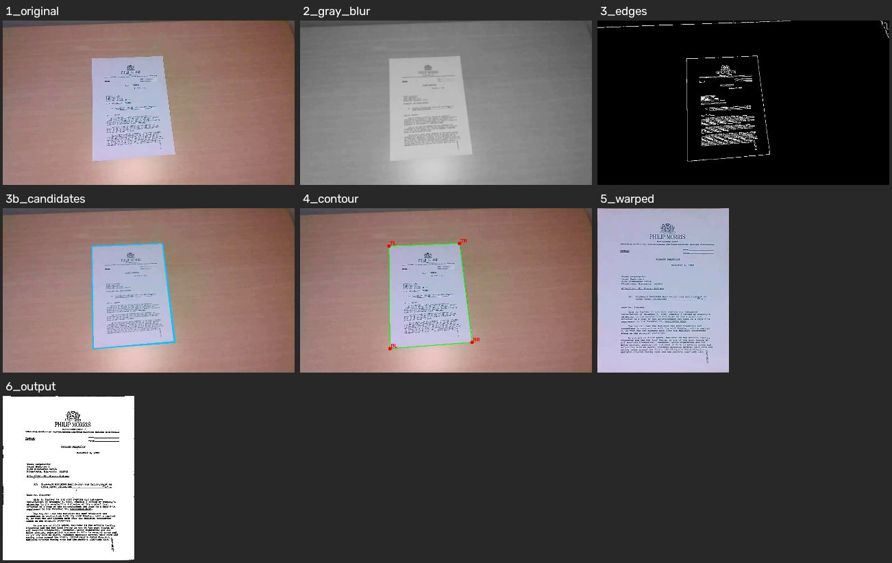
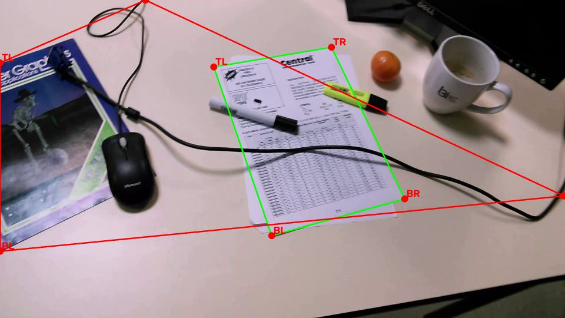
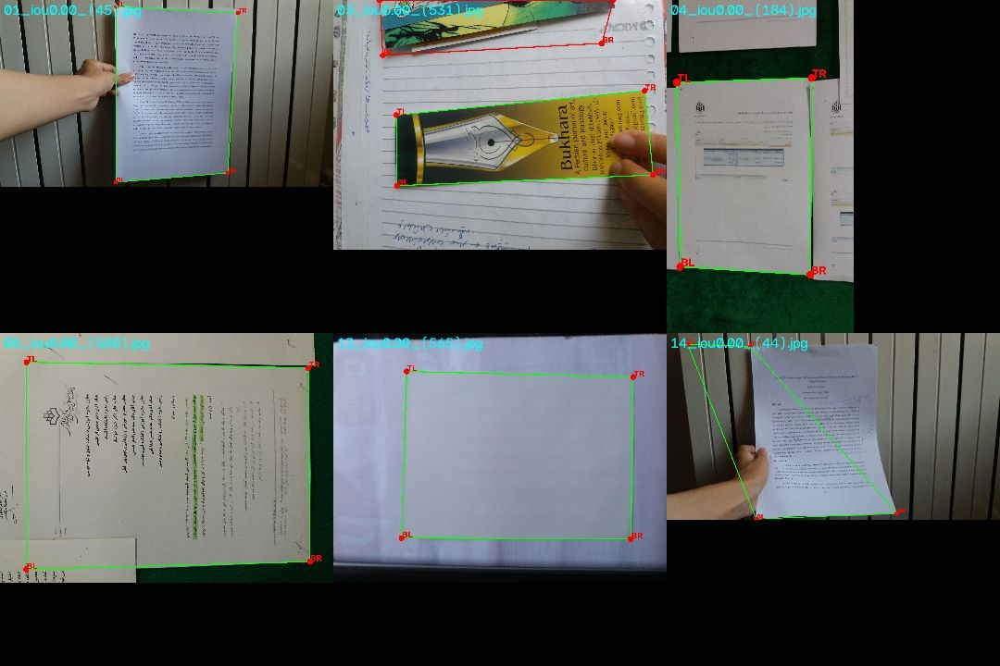

# Етап 3. Тестування та налаштування

## Датасети

| Датасет | Що це | Розмітка | Особливості |
|---------|-------|----------|-------------|
| Mendeley «Document Corner Localization» | ~1100 фото з телефона | 4 кути в `.csv` | документи в руці, зігнуті, пістрявий фон, кольорові буклети |
| SmartDoc 2015 Challenge 1 | 150 відео (5 фонів × 6 типів документів) | 4 кути для кожного кадру | аркуш займає лише ~11 % кадру, низькоконтрастні фони |
| Синтетика (`make_synthetic.py`) | 9 згенерованих випадків | точні кути | контрольовані умови |

Метрика — **IoU** (Jaccard) між знайденим і розміченим чотирикутником. Успіх — IoU ≥ 0.9.

## Базовий прогін (стратегія `simple`)

| Датасет | Вибірка | Успіх IoU ≥ 0.9 | Знайдено хоч щось |
|---------|---------|-----------------|-------------------|
| Mendeley | 200 фото | 14 % | 54 % |
| SmartDoc | 300 кадрів | 13 % | 13 % |

**Аналіз помилок:**
- SmartDoc: на фоні `background03` успіх 56 % (IoU ≈ 0.98, тобто гомографія працює),
  на 4 інших фонах — **0 %**. Причина: білий аркуш на світлому/помаранчевому столі
  в grayscale майже не відрізняється від фону, а автопоріг Canny за медіаною яскравості
  (≈ 95/188) занадто високий — межа аркуша не виділяється.
- Mendeley: у 47 % фото не знайдено жодного 4-кутника (кольорові документи на пістрявому
  фоні, рука закриває кут); резервна стратегія часто бере неправильний контур (IoU ≈ 0.56).

## Покращення: стратегія `multi`

1. **Кілька карт країв** замість однієї: Canny на яскравості з автопорогом і з низьким
   порогом; Canny **на кожному каналі B, G, R** окремо (межа «білий папір / помаранчевий стіл»
   помітна за кольором, але не за яскравістю); межі областей після **бінаризації Otsu**
   яскравості та насиченості.
2. **Збір усіх кандидатів** — опуклих 4-кутників з усіх карт.
3. **Вибір найкращого** за оцінкою `контраст × опора на краї × площа^0.25`:
   - контраст — різниця середнього кольору (Lab) всередині й у смузі навколо;
   - опора — частка периметра, що лежить на знайдених краях;
   - площа — слабка перевага більших кандидатів.
4. `min_area` знижено з 10 % до 5 % кадру (у SmartDoc аркуш займає 8.5–17 %).

Експерименти на вибірці для налаштування (47 фото Mendeley, 56 кадрів SmartDoc):

| Варіант | Mendeley | SmartDoc |
|---------|----------|----------|
| `simple` (базовий) | 19 % | 18 % |
| нижчі пороги Canny (20/60) | 26 % | 61 % |
| Canny на каналах BGR (20/60) | 23 % | 84 % |
| кілька карт, найбільший кандидат | 21 % | 80 % |
| кілька карт, вибір за контрастом × опорою × площею | 38 % | 86 % |
| **+ карти Otsu (`multi`, обрано)** | **43 %** | **86 %** |
| *«оракул» — найкращий з кандидатів* | *55 %* | *88 %* |

«Оракул» показує стелю для поточного набору кандидатів: на SmartDoc вибір майже ідеальний,
на Mendeley обмеження — у самих кандидатах (зігнуті аркуші, перекриття рукою).

Ціна: час зростає з ~7 до ~35 мс на зображення.

## Повний прогін після покращень

Ті самі зображення, що й у базовому прогоні (200 фото Mendeley, 300 кадрів SmartDoc —
кожен 50-й кадр), тобто порівняння чесне.

| Датасет | Стратегія | IoU ≥ 0.9 | IoU ≥ 0.8 | Знайдено | Медіана IoU | Час |
|---------|-----------|-----------|-----------|----------|-------------|-----|
| Mendeley | simple | 14.0 % | 17.5 % | 54 % | 0.22 | 13 мс |
| Mendeley | **multi** | **39.5 %** | **46.5 %** | 90 % | 0.77 | 73 мс |
| SmartDoc | simple | 12.7 % | 12.7 % | 13 % | 0.00 | 6 мс |
| SmartDoc | **multi** | **85.0 %** | **85.3 %** | 93 % | 0.98 | 56 мс |

SmartDoc за фонами (IoU ≥ 0.9): background01 — 100 %, 02 — 100 %, 03 — 99 %,
04 — 81 %, **05 — 0 %**. За типами документів — від 76 % (tax) до 90 % (letter, patent).

Яка карта країв дала переможця (Mendeley / SmartDoc): `bgr_low` 68 / 132, `bgr_high` 37 / 79,
`gray_low` 33 / 33, Otsu разом 30 / 26, `gray_auto` 12 / 10. Тобто класичний Canny на
grayscale з автопорогом (`simple`) перемагає лише у ~5 % випадків — головний внесок дають
кольорові канали.

## Аналіз помилок

### SmartDoc, background05 — 0 %

Захаращений стіл: кабель миші й маркери **перетинають межу аркуша**, а сам аркуш лежить
на іншому аркуші. Контур документа розривається на частини, і жоден 4-кутник не збігається
з ним; натомість обирається великий хибний контур (кабель + край столу).

### Mendeley — типові причини (найгірші випадки)

| Причина | Приклад |
|---------|---------|
| Аркуш тримають у руці — рука перекриває край, контур не замкнений | (45) |
| Кілька документів / кольорових предметів у кадрі — обрано не той | (531) |
| Документ щільно оточений іншими аркушами того ж кольору | (184) |
| Документ займає майже весь кадр і торкається його меж | (580) |
| Білий аркуш на білій стіні, розмите фото — майже нульовий контраст | (565) |
| **Помилка розмітки датасету** — еталонні кути перехрещені | (44) |

Розподіл IoU на Mendeley після покращення: 0 — 24 фото, 0–0.5 — 53, 0.5–0.8 — 30,
0.8–0.9 — 14, ≥ 0.9 — 79. Група 0.8–0.9 — переважно зігнуті аркуші: чотирикутник
описує їх лише наближено.

### Спроба, яку відхилено

Щоб ловити документи, що торкаються меж кадру, на карти країв домальовувалась рамка кадру.
Результат на вибірці для налаштування: Mendeley 43 % → 51 %, але SmartDoc 86 % → 77 %
(край столу разом з рамкою утворює хибні 4-кутники). Варіант «рамка лише для однієї карти»
дав +4 % / −2 % — у межах шуму на 47 фото, тому зміну не прийнято.

## Покращення v2: прямі, фільтр, підбір параметрів

### Методика: поділ на tune / test

Щоб не підганяти параметри під ті самі зображення, на яких рахуються результати, дані
поділено детерміновано (`datasets.split_of`):
- **SmartDoc** — за документом: документи 001–002 кожного типу → tune, 003–005 → test
  (кадри одного відео майже однакові, тому їх не можна розносити в різні частини);
- **Mendeley** — за хешем CRC32 назви файлу: ~30 % → tune.

Параметри підбирались лише на tune (`src/tune.py`, 338 фото Mendeley + 224 кадри SmartDoc),
підсумкові цифри — на test, який під час налаштування не використовувався.

### Що додано

1. **Фільтр правдоподібності** (`is_plausible`): внутрішні кути в межах [50°, 130°], площа
   від 5 % до 95 % кадру, кути не далі 10 % за межами кадру.
2. **Кандидати з прямих** (`line_quads`): відрізки LSD на яскравості й каналах BGR →
   дві групи за напрямком (k-means на подвоєному куті) → 4-кутники з перетинів двох пар прямих.
   Кожна сторона має лежати на краях щонайменше на 70 % довжини.
   Знаходить документ, навіть коли частину сторони закриває рука.
3. **Правило «прямі всередині контура»**: якщо переможець з прямих на ≥ 90 % лежить
   усередині найкращого контура — обирається контур. Без цього правила прямі часто
   «склеювались» з меж колонок журналу всередині сторінки (на SmartDoc test: −6.5 %).
4. **Уточнення сторін** (`refine_quad`, `cv2.fitLine` з функцією Хубера) — реалізовано,
   але на tune не дало приросту, тому за замовчуванням вимкнено (`--set refine=true`).
5. **Підбір параметрів** перебором сітки (`src/tune.py`): кандидати й їхні ознаки рахуються
   один раз, сотні комбінацій перевіряються лише перерахунком оцінки. Результат —
   `docs/tuning_results.json`.

### Внесок кожної зміни (tune, IoU ≥ 0.9)

| Варіант | Mendeley | SmartDoc |
|---------|----------|----------|
| multi v1 (до покращень) | 39.6 % | 86.2 % |
| + фільтр | 42.0 % | 86.2 % |
| + фільтр + уточнення сторін | 42.0 % | 85.7 % |
| + фільтр + прямі (вага 0.5) | 48.2 % | 85.3 % |
| + підібрані параметри (кут 50°, площа^0.5) | 47.9 % | 86.6 % |
| **+ правило «прямі всередині контура» (обрано)** | **44.7 %** | **87.1 %** |

На tune правило «всередині контура» трохи знижує Mendeley, але на test виявилось, що без
нього SmartDoc падає з 78.9 % до 72.4 % — тобто версія без правила була перенавчена на tune.

### Підсумок на test

| Стратегія | Mendeley (300 фото) | SmartDoc (341 кадр) | Час* |
|-----------|---------------------|---------------------|------|
| `simple` | 13.0 % | 20.2 % | 12–33 мс |
| multi v1 | 35.0 % | 78.9 % | 83–126 мс |
| multi v2 без правила «всередині» | 41.3 % | 72.4 % | 257–335 мс |
| **multi v2 (за замовчуванням)** | **42.7 %** | **86.8 %** | 289–362 мс |

\* час виміряно у віртуальній машині, приблизно в 2–2.5 рази повільніше за звичайний ПК.

IoU ≥ 0.8: Mendeley 48.7 %, SmartDoc 86.8 %. Медіана IoU: 0.78 / 0.98.
SmartDoc за фонами: 01 — 100 %, 02 — 97.6 %, 03 — 100 %, 04 — 87.9 %, 05 — 0 %.
На Mendeley кандидати з прямих перемагають у 55 з 300 фото, на SmartDoc — лише у 5:
прямі допомагають саме там, де контур розірваний (рука, нерівний край).

## Відомі обмеження

1. **Модель «документ = опуклий чотирикутник».** Зігнуті, зім'яті аркуші та аркуші з
   загнутим кутом описуються лише наближено (IoU 0.8–0.9).
2. **Перекриття межі** (рука, кабель, предмети на аркуші) розриває контур.
3. **Кілька схожих об'єктів** у кадрі: обирається найконтрастніший, не обов'язково потрібний.
4. **Документ на межі кадру** або поза нею: контур не замкнений, кути поза кадром неможливо знайти.
5. **Дуже низький контраст** (білий на білому, розмиття): допомагає лише ручний режим `--manual`.
6. Стратегія `multi` у ~10–25 разів повільніша за `simple` (~150–350 мс проти 6–30 мс на кадр),
   але придатна для обробки фото; для відео в реальному часі краще `simple` або трекінг.
7. Захаращений фон з предметами поверх аркуша (SmartDoc background05) — 0 % навіть з прямими.

**Можливі покращення:** нейромережева сегментація документа (наприклад, навчена на
DocCornerDataset) — для складних фонів; для відео — трекінг кутів між кадрами.
